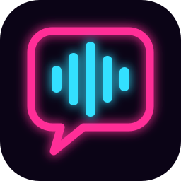
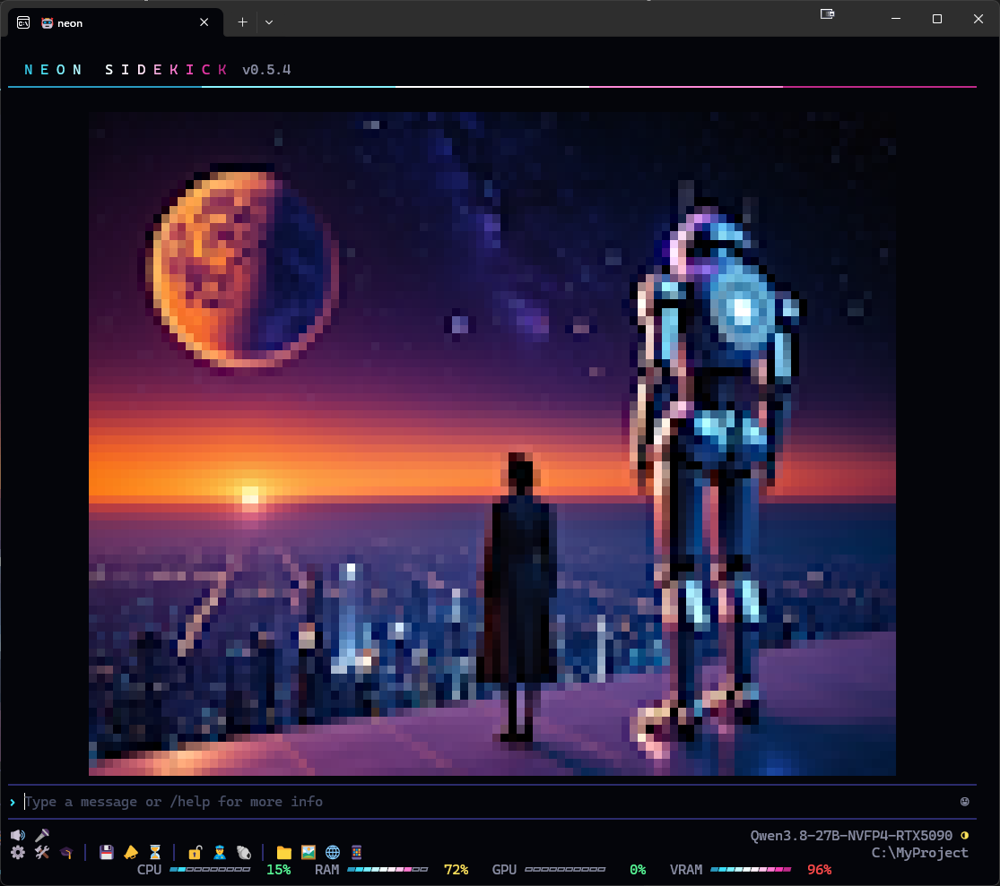

#  Neon Sidekick

Neon Sidekick is an AI agent for your terminal, built for local LLMs on consumer hardware. It runs best on a graphics card with 16 GB of VRAM or more, or on an Apple Silicon Mac. On a 32 GB card such as an RTX 5090, it runs larger models with room for long context.

Point it at LM Studio, Ollama or any OpenAI-compatible server on your PC or your network, or let it download a model and run it itself. When you want a frontier model, or don't have the hardware for a local one, it connects to the OpenAI and Anthropic APIs with your own key, or to Claude Code through your subscription.

It's one app for research, IT and admin work such as Active Directory, event logs and databases, your smart home through Home Assistant, and creative projects through ComfyUI. For developers, it's a coding agent and a stable C# and .NET 10 base for building and testing new agentic tools.

**What makes it different**
* **Built for local models:** it recovers when a local model fumbles a tool call or runs short of context, and the models it downloads are ones tested with its tools.
* **Long jobs on a small context window:** with `/plan` the model reviews its own plan until no gaps are left, then carries it out one step at a time (the Ralph loop), each step in a fresh conversation and checked before the next.
* **Frontier help when you want it:** pair your local model with a frontier advisor it can ask whenever it's stuck, and that reviews its plans and checks its steps, so you pay for frontier tokens only where they count.
* **Built in, not scripted:** the database, admin and smart-home tools are native code in the app and talk to each system directly, so a small model makes one simple call instead of writing a script, with nothing else to install.
* **Guardrails in code, not in the prompt:** databases are read-only by default and Active Directory always, and the shell police blocks harmful commands and paths outside the working folder, even when you let the model run commands without asking.
* **Set up without editing files:** on first launch it finds a server on your network, downloads a model or takes your API key, and wizards add each database, share or remote computer and warn when the account could change data.
* **Talk to it, or use your phone:** voice in and out, and the Web UI puts your phone in the same live session as the terminal.
* **No black box:** `/sys` shows the exact prompt and every tool, and the persona and operating rules are files you can edit.

  

<b><a href="https://github.com/M0j0Risin/NeonSidekick/releases/latest">Download the latest release</a></b> · Windows x64 · macOS on Apple Silicon · unpack and run

## Contents

- [Features](#features)
- [Getting started](#getting-started)
- [Using the app](#using-the-app)
- [About](#about)
- More documentation:
  - [The interface, in full](docs/INTERFACE.md): every key, bar and window
  - [Slash commands](docs/COMMANDS.md)
  - [Tools](docs/TOOLS.md)
  - [Settings reference](docs/SETTINGS.md)
  - [On a Mac](docs/MAC.md)
  - [Headless and scripted runs](docs/HEADLESS.md)
  - [Command-line options](docs/COMMANDLINE.md)
  - [Environment variables](docs/ENVIRONMENT.md)
  - Setup guides: [SearXNG](docs/DOCKER_WINDOWS_SEARXNG.md), [vLLM](docs/DOCKER_WINDOWS_VLLM.md), [SGLang](docs/DOCKER_WINDOWS_SGLANG.md) and [Home Assistant with MQTT](docs/DOCKER_WINDOWS_HOMEASSISTANT.md) in Docker on Windows
- For developers:
  - [Building from source](docs/BUILD.md)
  - [Components & libraries](docs/COMPONENTS.md)
  - [Test containers](docs/TESTCONTAINERS.md)

## Features

### The app
* **A rich terminal UI:** Markdown, code highlighting, pictures in the transcript, the mouse, and sixty color themes or your own.
* **Its own windows:** pictures and thumbnails (`/view`), the camera (`/camera live`), the log (`/log`), background output (`/process`), a container's live log (`/docker logs`) and a YouTube player (`/youtube play`).
* **Voice in and out:** Whisper speech-to-text (push-to-talk or "hey neon") and Kokoro speech with voices you can mix, both in-process or through a Kokoro server.
* **Web UI:** the chat, the model's questions, the shopping list, a Home tab (rooms, lights, scenes, cameras and the PC's meters) and a YouTube player on your phone, over your home network or Tailscale (`/webui`, [the Web UI](docs/INTERFACE.md#web-ui)).
* **Pictures as input:** paste or drop one, or take one with the webcam (`/camera`) or of the screen (`/screen`).
* **No installer:** unzip and run. It's compiled to native code, so it starts fast and needs no .NET runtime.
* **Auto-complete** for commands, files, folders, skills and tools, and **find** in the transcript (`/find`).
* **Message queue:** keep typing while the model works; messages go out in order, and `/loop` repeats one.
* **Saved prompts:** messages you send often, picked from a list (`/prompts`) or from your phone.
* **Headless mode:** `--headless` runs over stdin/stdout for scripts and scheduled jobs ([HEADLESS.md](docs/HEADLESS.md)).

### Models
* **Local servers:** finds OpenAI-compatible servers on the computer running NeonSidekick or your network, or takes a URL.
* **Embedded model:** the app downloads a Gemma, Qwen or Muse model (all read pictures and call tools) and runs it on a built-in llama.cpp.
* **Model sizes:** builds for 8 GB cards and up, best at 16–32 GB, and NVFP4 builds for NVIDIA's Blackwell cards (Windows only).
* **Docker servers (Windows only):** your vLLM or SGLang containers as `/server` choices, one running at a time ([vLLM](docs/DOCKER_WINDOWS_VLLM.md) and [SGLang](docs/DOCKER_WINDOWS_SGLANG.md) examples).
* **Cloud models:** the Anthropic and OpenAI APIs with your own key, or Claude Code as the chat's server (`/claude` sends it one message); all off until you turn them on.
* **Advisors:** any other profile, local or frontier, can be one; ask it yourself with `/advisor`. Advisors use only read-only tools.
* **Benchmarks & meters:** `/test` benchmarks the model, and the performance bar shows CPU, RAM, GPU and network while it works.

### Conversations, memory & skills
* **Profiles:** each has its own settings, persona, emoji avatar (`/avatar`), memory, sessions and working directory (the folder the model works in).
* **Sessions:** resume, search and learn from past conversations, or export one to Markdown or HTML.
* **Memory:** facts you can edit, added to every conversation.
* **Project notes:** reads the working directory's `NEON.md`, else `AGENTS.md`, else `CLAUDE.md`, so a project's own rules come along.
* **Context control:** compaction keeps the conversation inside the model's window; `/compact` and `/rewind` do it by hand, and `/sys` shows what the model is sent.
* **Skills:** the profile's own, global ones, and the read-only `~/.agents/skills` other agents use; `/skills add` installs more from [skills.sh](https://skills.sh) or GitHub.
* **Managing skills:** edit, move, copy, lock, disable or revert a skill (its last 10 versions) on `/skills`. The model's `skill_editor` never deletes one.
* **Self-learning:** a background reflection writes new skills and improves existing ones from your work.

### Tools & guardrails
* **Built-in tools:** files, Git, shell (PowerShell, cmd, bash, zsh), scripts (PowerShell, Python, Node), questions to you, clock, timers and `neon_help`, the app's own manual.
* **MCP servers:** add Model Context Protocol servers, outside programs with more tools and data.
* **Integrations:** the research, IT, smart home and creative tools below, once you switch them on in `/tools` ([TOOLS.md](docs/TOOLS.md)).
* **Sandboxed:** file tools reach only the working directory; shell commands go through an approval pane (once, this session, or always).
* **Undo:** `/undo` puts back the files a turn changed, and `/rewind` can take them back with the conversation.
* **Shell police (👮):** refuses a command naming a path outside the working directory, a forbidden string (disk wipes, shutdowns…) or the database tools' databases, even under `--yolo` ([Shell guards](docs/SETTINGS.md#shell-guards)).

### Plans & reviews
* **Plan mode:** `/plan <requirement>` researches with read-only tools and saves a plan; nothing changes until you approve. `/plan chat` talks a plan through with you first.
* **Closing gaps:** `/plan gaps` has the model or an advisor review a plan pass after pass, fixing what would stall the work, until it comes up clean ([Closing gaps](docs/COMMANDS.md#closing-gaps)).
* **Ralph loop:** carries out an approved plan one step at a time, each step a fresh pass checked before moving on ([Ralph loop](docs/COMMANDS.md#ralph-loop)).
* **Code audit:** `/code-audit` reviews the code with read-only tools, pass after pass, into a report you can turn into a plan.

### Research & notes
* **Web search & pages:** searches with DuckDuckGo or your own SearXNG server, reads pages (in a real browser when a page needs one), and downloads files.
* **A web browser** (`/browser`): sign in to a site or pass its bot check there, and the web tools borrow its cookies.
* **PDFs:** the model reads them, on disk or on the web; attach one to a message, `/view` it, or merge, split, rotate and fill them in.
* **Office files:** the model reads Word documents, Excel workbooks and PowerPoint decks; `/read` reads a document or deck aloud.
* **Obsidian:** search, read, write and link notes in your vault.

### IT & admin
* **Databases:** SQL Server, Oracle, MySQL/MariaDB, PostgreSQL, SQLite and DuckDB (with the CSV, Parquet and JSON files in your folder). Read-only by default; writes are opt-in per connection and ask first. Passwords are stored encrypted.
* **Files elsewhere:** network shares (`\\server\share` or `//server/share`, and `smb://` on a Mac) and outside folders, as you or another account.
* **Docker:** containers' logs, health and resource use. Starting, stopping and cleaning up are opt-in and ask first; `/docker` does it by hand.
* **Network checks:** DNS lookups, ping, traceroute, open ports and TLS certificates, one host at a time; `/net` does it by hand.
* **Event logs:** crashes, failed service starts and sign-ins, on the app's computer, in `.evtx` files or on computers you name. Read-only; `/eventlog` does it by hand.
* **Services & scheduled tasks (Windows only):** read them here or on computers you name; changes are opt-in and ask first (`/services`, `/tasks`).
* **Active Directory:** users, groups, computers and OUs, and the locked, expiring, stale and privileged accounts. It never writes to the directory; `/ad` does it by hand.
* **Printing:** `/print` to any printer, and `/pdf` makes a PDF from Markdown, text, pictures or a web page.

### Smart home
* **Home Assistant:** lights, scenes, the TV, to-do lists, sensors and cameras ("dim the den to 30%"); `/ha` drives the house directly.
* **Shopping list:** one per profile, in your store's aisle order, learning where things are; on your phone too (`/shopping`).
* **Monitors (Windows only):** switch a monitor's input over DDC/CI, or extend, duplicate or pick one screen, from the home bar's 🖥️ or `/monitor`.

### Creative
* **ComfyUI:** pictures from your own workflows (text-to-image, image-to-image, face swaps), or `/imagine` with your own prompt.
* **Picture editing:** resize, crop, rotate, recolor, convert or strip metadata, by the model or with a right-click in the viewer.
* **Bot chat:** `/botchat` lets your profiles talk to each other in their own voices, optionally illustrated by ComfyUI.
* **YouTube:** search (with your API key) and play videos in the app, a browser or the Web UI; saved videos resume where you left off.

## Getting started

### What you need
* **A 64-bit Windows PC** with an Intel or AMD processor with AVX2 (from about 2015 on), or an Apple Silicon Mac (M1 and later). Nothing else to install.
* **Windows Terminal:** it comes with Windows 11, and the app is designed for it. On a Mac, use [iTerm2](https://iterm2.com): the app works best there ([why](docs/MAC.md#install-and-first-run)). Terminal.app works too, with less.
* **A language model:** the app can download one and run it, use one you already run, or connect to the OpenAI or Anthropic API, or to Claude Code on your Claude subscription.
* **For local models, a graphics card with 16 GB of VRAM or more** (NVIDIA with driver 580 or newer, or any Vulkan card) **or an Apple Silicon Mac.** Without one they run, but slowly.

Only for some features:
* **Web pages that need a real browser, and PDFs:** Edge, Chrome or Brave (or Chromium on a Mac).
* **`/claude` and the Claude Code server:** Claude Code installed.
* **Scripts in Python or Node:** Python or Node installed.
* **Better web search:** a SearXNG server ([setup with Docker](docs/DOCKER_WINDOWS_SEARXNG.md)), or an MCP web-search server.
* **The integrations:** the thing itself, such as Home Assistant, ComfyUI, Docker Desktop, an Obsidian vault or a YouTube API key.

**On a Mac?** A few features need Windows or macOS 14, and [On a Mac](docs/MAC.md) covers setup and every difference.

### Install
1. Download `NeonSidekick-v<version>-win-x64.zip` from the [Releases page](https://github.com/M0j0Risin/NeonSidekick/releases).
2. Unzip it into any folder and run `NeonSidekick.exe`. Keep everything in the folder together.
3. The app isn't signed, so Windows may say it protected your PC: choose **More info**, then **Run anyway**.

On a Mac:
1. Download `NeonSidekick-v<version>-osx-arm64.tar.gz` from the same page and unpack it (double-click, or `tar -xzf`).
2. The build isn't notarized, so clear macOS's quarantine once: `xattr -dr com.apple.quarantine NeonSidekick-v<version>-osx-arm64`.
3. In iTerm2 (recommended) or Terminal, run `./NeonSidekick` in that folder. Keep everything in the folder together.
4. When macOS asks whether the app may use its Keychain key, choose **Always Allow**. For the Ctrl+Option shortcuts, let Option act as Meta ([how](docs/MAC.md#install-and-first-run)).

**Updating:** unpack the new version into a fresh folder (on a Mac, clear its quarantine again). Your settings, memories and conversations live in `.neonsidekick`, not the app's folder, so they carry over.

Each download's `.sha256` file lets you check it arrived intact (`Get-FileHash` on Windows, `shasum -a 256` on a Mac).

### First launch
If the app has no model to connect to when it starts, or when you switch to such a profile, it opens **Connect a model**:

| Choice | When to pick it |
|---|---|
| Scan for local servers | You run LM Studio, Ollama, llama.cpp, vLLM or SGLang on the app's computer or your network. It asks where to look (*LLM server scan mode*) while that's off. |
| Enter a server's URL | You know the address of an OpenAI-compatible server. |
| Download an embedded model | You have no server: the app runs a model itself, best on a suitable graphics card or a Mac. |
| Connect Docker container | You run vLLM or SGLang in Docker Desktop (Windows only). |
| Use the Anthropic API / Use the OpenAI API | You have an API key (billed per message). |
| Use Claude Code | You have Claude Code and a Claude subscription. |

Pick one and the app walks you through it, switching that server on for you; Esc skips. Then type a message and press Enter.

**Good to know:**
* **Permissions:** the model can't touch your files, the web or the shell until you allow it; see [What the model may do](#what-the-model-may-do).
* **Your data:** settings, memories and conversations are saved in `%USERPROFILE%\.neonsidekick` (`~/.neonsidekick` on a Mac).
* **Switching servers:** `/server` lists the servers it finds; embedded models, the APIs, Claude Code and Docker appear once switched on in `/settings` › Servers, and Connect a model switches on the one you pick.
* **Voice:** off at first. `/tts` turns on spoken replies and `/stt` voice input; each first downloads what it needs (about 330 MB and 150 MB).
* **Desktop shortcut:** each profile offers one once (it can also write a log); `/shortcut` makes one later.

### Useful first commands
| Command | What it does |
|---|---|
| `/help` | Every command and key. |
| `/tools` | Chooses what the model may do: files, web, shell and more. |
| `/cwd` | Changes the working directory, the folder the model works in. |
| `/plan <requirement>` | Plans a change with read-only tools; nothing changes until you approve. |
| `/webui` | Puts the chat on your phone: turn the Web UI on and scan its QR code. |

Type `/` to list every command; [COMMANDS.md](docs/COMMANDS.md) has them all, and [COMMANDLINE.md](docs/COMMANDLINE.md) the options to start the app with.

### What the model may do

| Setting | Where | What it does | Default |
|---|---|---|---|
| File tools | `/tools` › Files › File | The model reads and writes files in the working directory. | off |
| Image tools | `/tools` › Files › Image | The model looks at and edits pictures. | off |
| Web tools | `/tools` › Core › Web | The model searches the web and reads pages. | off |
| Shell command policy | `/tools` › Core › Shell | `off`, `ask` (you approve any command not on the allowed list) or `yolo` (no asking). | `off` |
| Memory mode | `/settings` › Client › Chat | Whether the model saves facts about you between conversations. | `read-write` |

## Using the app

The short version: [INTERFACE.md](docs/INTERFACE.md) has every key, bar and window, and [SETTINGS.md](docs/SETTINGS.md) every setting.

### The input line
* **Enter** sends; during a reply it queues the message. **Ctrl+Enter** starts a new line.
* **Esc** stops a reply; twice on an empty line it opens `/rewind`.
* **↑/↓** bring back earlier messages.
* **`/`** lists commands, **`@`** files and folders, **`#`** skills and **`$`** tools.
* **A right-click or Alt+V** pastes a copied picture (Windows Terminal keeps Ctrl+V for text; on a Mac, see [What differs](docs/MAC.md#what-differs)).
* **Ctrl+O** opens or folds tool calls, code, diffs and thinking.
* **☺** at the line's right end opens an emoji picker (Ctrl+J too, on Windows); the *Emoji picker* setting hides it.

### Handy shortcuts

| Shortcut | Does |
|---|---|
| Ctrl+H | `/help`: every command and key |
| Ctrl+F | `/find`: find words in the transcript |
| Ctrl+S | `/server`: pick the LLM server |
| Ctrl+M | `/model`: pick the model |
| Ctrl+R | `/reasoning`: how hard the model thinks |
| Ctrl+P | `/profile`: switch profile |
| Ctrl+Z | `/theme`: pick a color theme |
| Ctrl+Alt+W | `/webui`: the Web UI and its QR code |
| Ctrl+Alt+N | `/new`: a new conversation, keeping the screen |
| Ctrl+Alt+C | `/clear`: a new conversation on a cleared screen |

On a Mac, Ctrl+D picks the model (a Mac terminal sends Ctrl+M as Enter). `/help` › Keys and [Keyboard shortcuts](docs/INTERFACE.md#keyboard-shortcuts) list every key.

### The bars
* **The [hints bar](docs/INTERFACE.md#the-hints-bar)**, under the input line, shows the keys that apply right now.
* **The [status bar](docs/INTERFACE.md#the-status-bar)** shows the model, the context used and what runs in the background; double-click the model to switch.
* **The [toolbar](docs/INTERFACE.md#the-toolbar)** has an icon per pane and tool group: click to see what it is, double-click to open it. `/toolbar` hides it.
* **The [performance bar](docs/INTERFACE.md#the-performance-bar)** shows CPU, RAM, GPU and VRAM once a second; `/perfbar` hides it.

### Panes

Everything is set from panes, and each explains itself: the highlighted row's description and default show under the list.

| Pane | Opens with | What's in it |
|---|---|---|
| `/settings` | Ctrl+/ or `//` | The app: chat, sessions and botchat (Client), the model servers (Servers), advisors, the plan reviews, Ralph loop and code audits (Automation), and voice. |
| `/tools` | Ctrl+T | Which tools the model may use, and their options. |
| `/skills` | Ctrl+Alt+S | Agent skills and self-learning. |
| `/mcp` | Ctrl+Alt+D | External MCP servers. |
| `/sys` | Ctrl+Y | What the model is sent. |
| `/usage` | Ctrl+U | Speed and token statistics. |

A [command-line option](docs/COMMANDLINE.md) or an [environment variable](docs/ENVIRONMENT.md) can override a few settings for one launch.

### Getting around
* **Keyboard:** ←/→ switch tabs (and the sub-tabs on a second row), Tab skips to the next main tab, ↑/↓ move, Enter edits or toggles, Space flips an on/off row, Esc closes.
* **Mouse:** a double-click picks a row or tab; the × at the top right closes the pane.
* **Lost?** Ask the model where a setting is, or why it can't use a tool; its `neon_help` tool knows them all.

## About

**Inspiration:** I started out using Claude Code, Hermes Agent and Cline, and kept wishing one app had the parts I liked from each, with more utilitarian tools, running on my own hardware. Neon Sidekick is that app.

**Why "Neon":** early on I was trying synthwave-style themes in Spectre.Console while testing the Vosk voice integration. I needed a short, punchy wake word, and "Neon" fit the look. The name stuck.

**License:** GPLv3; see [LICENSE](LICENSE). Built on the libraries in [COMPONENTS.md](docs/COMPONENTS.md).
