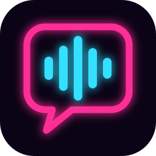
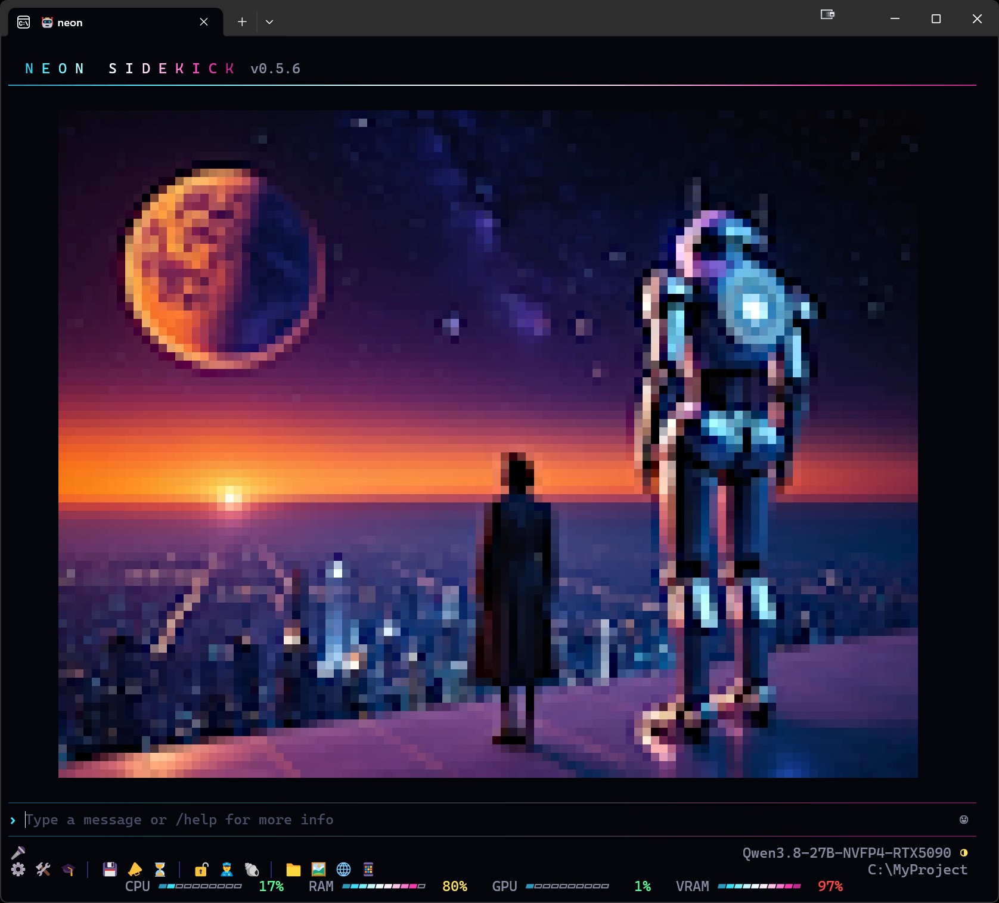

#  Neon Sidekick

Neon Sidekick is an AI agent for your terminal, built for local LLMs on consumer hardware. It runs best with 16 GB of VRAM or more, or on an Apple Silicon Mac; a 32 GB card such as an RTX 5090 runs larger models with long context.

Point it at LM Studio, Ollama or any OpenAI-compatible server on your PC or network, or let it download and run a model itself. For a frontier model, it connects to the OpenAI and Anthropic APIs with your own key, or to Claude Code through your subscription.

It's one app for research, IT and admin work (Active Directory, event logs, databases), your smart home through Home Assistant, and creative projects through ComfyUI. For developers, it's a coding agent and a stable C# and .NET 10 base for building and testing agentic tools.

**What makes it different**
* **Built for local models:** it recovers when a model fumbles a tool call or runs short of context, and downloads only models tested with its tools.
* **Long jobs on a small context window:** `/plan` reviews the plan until no gaps remain, then the Ralph loop runs each step in a fresh conversation, checked before the next.
* **Frontier help when you want it:** a frontier advisor helps your local model when it's stuck, reviews its plans and checks its steps, so frontier tokens go only where they count.
* **Built in, not scripted:** databases, Active Directory, event logs, services, Docker, Office files and Home Assistant are native code that talks to each system directly, so a small model makes one call.
* **Guardrails in code, not in the prompt:** databases are read-only by default, Active Directory always, and the shell police blocks harmful commands and paths outside the working folder, even under `yolo`.
* **Set up without editing files:** it finds a server on your network, downloads a model or takes a key; wizards add databases, shares and remote computers, warning when an account could change data.
* **Talk to it, or use your phone:** voice in and out, and the Web UI puts your phone in the same live session.
* **More than a terminal:** its own windows show pictures, the camera, a web browser, YouTube, the log and background output when text isn't enough.
* **No black box:** `/usage` shows the prompt, every tool and every skill the model is sent, and the persona and operating rules are files you can edit.

  

<b><a href="https://github.com/M0j0Risin/NeonSidekick/releases/latest">Download the latest release</a></b> · Windows x64 · macOS on Apple Silicon · unpack and run

## Contents

- [Features](#features)
- [Getting started](#getting-started)
- [Using the app](#using-the-app)
- [About](#about)
- More documentation:
  - [The interface, in full](docs/INTERFACE.md): every key, bar and window
  - [Slash commands](docs/COMMANDS.md)
  - [Tools](docs/TOOLS.md)
  - [Settings reference](docs/SETTINGS.md)
  - [On a Mac](docs/MAC.md)
  - [Headless and scripted runs](docs/HEADLESS.md)
  - [Command-line options](docs/COMMANDLINE.md)
  - [Environment variables](docs/ENVIRONMENT.md)
  - Setup guides: [SearXNG](docs/DOCKER_SEARXNG_WIN_MAC.md), [vLLM](docs/DOCKER_VLLM_WIN.md), [SGLang](docs/DOCKER_SGLANG_WIN.md) and [Home Assistant with MQTT](docs/DOCKER_HOMEASSISTANT_WIN_MAC.md) in Docker (vLLM and SGLang on Windows only)
- For developers:
  - [Building from source](docs/BUILD.md)
  - [Components & libraries](docs/COMPONENTS.md)
  - [Test containers](docs/TESTCONTAINERS.md)

## Features

### The app
* **A rich terminal UI:** Markdown, code highlighting, pictures in the transcript, the mouse, and sixty color themes or your own.
* **Its own windows:** pictures (`/view`), the camera (`/camera live`), the log (`/log`), background output (`/process`), a container's log (`/docker logs`) and YouTube (`/youtube play`); camera and YouTube need macOS 14+ on a Mac.
* **Voice in and out:** Whisper speech-to-text (push-to-talk or "hey neon") and Kokoro speech with mixable voices, in-process or through a Kokoro server.
* **Web UI:** the chat, the model's questions, the shopping list, a Home tab (lights, scenes, cameras, PC meters) and YouTube on your phone, over your network or Tailscale (`/webui`, [the Web UI](docs/INTERFACE.md#web-ui)).
* **Pictures as input:** paste or drop one, or take one with the webcam (`/camera`) or of the screen (`/screen`) (macOS 14+ on a Mac).
* **No installer:** unzip and run. Native code, so it starts fast and needs no .NET runtime. It updates itself when you say so (`/update`).
* **Auto-complete** for commands, files, folders, skills and tools, and **find** in the transcript (`/find`).
* **Message queue:** keep typing while the model works; messages go out in order, and `/loop` repeats one.
* **Saved prompts:** messages you send often, picked from a list (`/prompts`) or your phone.
* **Custom commands:** your own slash commands, one Markdown file each in Claude Code's format, your words filled in (`/commands`).
* **Headless mode:** `--headless` runs over stdin/stdout for scripts and scheduled jobs ([HEADLESS.md](docs/HEADLESS.md)).

### Models
* **Local servers:** finds OpenAI-compatible servers on the app's computer or your network, or takes a URL.
* **Embedded model:** downloads a Gemma, Qwen or Muse model (all read pictures and call tools) and runs it on a built-in llama.cpp.
* **Model sizes:** builds for 8 GB cards and up, best at 16–32 GB, and NVFP4 builds for NVIDIA's Blackwell cards (Windows only).
* **Docker servers (Windows only):** your vLLM or SGLang containers as `/server` choices, one at a time ([vLLM](docs/DOCKER_VLLM_WIN.md), [SGLang](docs/DOCKER_SGLANG_WIN.md)).
* **Cloud models:** the Anthropic and OpenAI APIs (your key) or Claude Code as the server (`/claude` sends it one message); off until you turn them on.
* **Advisors:** any other profile, local or frontier, can be one, with read-only tools only; `/advisor` asks it yourself.
* **Benchmarks & meters:** `/test` benchmarks the model; the performance bar shows CPU, RAM, GPU and network.

### Conversations, memory & skills
* **Profiles:** each has its own settings, persona, emoji avatar (`/avatar`), memory, sessions and working directory.
* **Sessions:** resume, search and learn from past conversations, or export one to Markdown or HTML.
* **Memory:** facts you can edit, added to every conversation.
* **Project notes:** reads the working directory's `NEON.md`, else `AGENTS.md`, else `CLAUDE.md`.
* **Context control:** compaction keeps the conversation inside the model's window; `/compact` and `/rewind` do it by hand.
* **Skills:** the profile's own, global ones and the read-only `~/.agents/skills` other agents use; `/skills add` installs from [skills.sh](https://skills.sh) or GitHub.
* **Managing skills:** edit, move, copy, lock, disable or revert (last 10 versions) on `/skills`; the model's `skill_editor` never deletes one.
* **Self-learning:** a background reflection writes and improves skills from your work.

### Tools & guardrails
* **Built-in tools:** files, Git, shell (PowerShell, cmd, bash, zsh), scripts (PowerShell, Python, Node), questions to you, clock, timers and `neon_help` (the app's manual).
* **MCP servers:** outside programs with more tools and data (Model Context Protocol).
* **Integrations:** the research, IT, smart home and creative tools below, once switched on in `/tools` ([TOOLS.md](docs/TOOLS.md)).
* **Sandboxed:** file tools reach only the working directory; shell commands go through an approval pane (once, this session, or always).
* **Undo:** `/undo` puts back the files a turn changed; `/rewind` can take them back with the conversation.
* **Shell police (👮):** refuses a command naming a path outside the working directory, a forbidden string (disk wipes, shutdowns…) or the database tools' databases, even under `--yolo` ([Shell guards](docs/SETTINGS.md#shell-guards)).

### Plans & reviews
* **Plan mode:** `/plan <requirement>` researches with read-only tools and saves a plan; nothing changes until you approve. `/plan chat` talks it through first.
* **Closing gaps:** `/plan gaps` has the model or an advisor review a plan, pass after pass, until nothing would stall the work ([Closing gaps](docs/COMMANDS.md#closing-gaps)).
* **Ralph loop:** carries out an approved plan one step at a time, each a fresh pass checked before the next ([Ralph loop](docs/COMMANDS.md#ralph-loop)).
* **Code audit:** `/code-audit` reviews the code with read-only tools, pass after pass, into a report you can turn into a plan.

### Research & notes
* **Web search & pages:** a built-in metasearch (Bing, Brave, DuckDuckGo, Startpage, Wikipedia) or your own SearXNG server; reads pages (in a real browser when needed) and downloads files.
* **A web browser** (`/browser`, macOS 14+ on a Mac): sign in to a site or pass its bot check, and the web tools borrow its cookies.
* **PDFs:** read on disk or the web, attached to a message or `/view`ed; merge, split, rotate and fill them in.
* **Office files:** the model reads Word documents, Excel workbooks and PowerPoint decks, and writes Word and Excel files (`/docx`, and query results to Excel); `/read` reads a document or deck aloud.
* **Obsidian:** search, read, write and link notes in your vault.

### IT & admin
* **Databases:** SQL Server, Oracle, MySQL/MariaDB, PostgreSQL, SQLite and DuckDB (with your folder's CSV, Parquet and JSON files). Read-only by default; writes are opt-in per connection and ask first; passwords are stored encrypted.
* **Files elsewhere:** network shares (`\\server\share` or `//server/share`, and `smb://` on a Mac) and outside folders, as you or another account.
* **Docker:** containers' logs, health and resource use; starting, stopping and cleaning up are opt-in and ask first (`/docker`).
* **Network checks:** DNS lookups, ping, traceroute, open ports and TLS certificates, one host at a time (`/net`).
* **Event logs:** crashes, failed service starts and sign-ins, on this computer, in `.evtx` files or on computers you name (a Mac reads its own logs: [On a Mac](docs/MAC.md#what-works)). Read-only (`/eventlog`).
* **Services & scheduled tasks (Windows only):** on this computer or ones you name; changes are opt-in and ask first (`/services`, `/tasks`).
* **Active Directory:** users, groups, computers, OUs and locked, expiring, stale or privileged accounts; it never writes to the directory (`/ad`).
* **Printing:** `/print` to any printer; `/pdf` makes a PDF from Markdown, text, pictures or a web page.

### Smart home
* **Home Assistant:** lights, scenes, the TV, to-do lists, sensors and cameras ("dim the den to 30%"); `/ha` drives the house directly.
* **Shopping list:** one per profile, in your store's aisle order, learning where things are; on your phone too (`/shopping`).
* **Monitors (Windows only):** switch a monitor's input over DDC/CI, or extend, duplicate or pick one screen (the home bar's 🖥️ or `/monitor`).

### Creative
* **ComfyUI:** pictures from your own workflows (text-to-image, image-to-image, face swaps), or `/imagine` with your prompt.
* **Picture editing:** resize, crop, rotate, recolor, convert or strip metadata, by the model or a right-click in the viewer.
* **Bot chat:** `/botchat` lets your profiles talk in their own voices, optionally illustrated by ComfyUI.
* **YouTube:** search (with your API key) and play in the app (macOS 14+ on a Mac), a browser or the Web UI; saved videos resume where you left off.

## Getting started

### What you need
* **A 64-bit Windows 10 or 11 PC** with an Intel or AMD processor with AVX2 (from about 2015 on), or an Apple Silicon Mac (M1 and later). No .NET runtime to install.
* **Windows Terminal:** the app is built for it. It comes with Windows 11; on Windows 10, install it from the Microsoft Store. On a Mac, [iTerm2](https://iterm2.com) works best ([why](docs/MAC.md#install-and-first-run)); Terminal.app works, with less.
* **A language model:** one the app downloads and runs, one you run, the OpenAI or Anthropic API, or Claude Code on your Claude subscription.
* **For local models, a graphics card with 16 GB of VRAM or more** (NVIDIA with driver 580 or newer, or any Vulkan card) **or an Apple Silicon Mac.** Without one they run slowly.

Only for some features:
* **Web pages that need a real browser, and PDFs:** Edge, Chrome or Brave (or Chromium on a Mac).
* **`/claude` and the Claude Code server:** Claude Code installed.
* **Scripts in Python or Node:** Python or Node installed.
* **`bash` on Windows:** Git Bash. **PowerShell on a Mac:** PowerShell 7 (`pwsh`).
* **The video and Browser windows on Windows 10:** the free Microsoft Edge WebView2 Runtime (Windows 11 has it).
* **Voice and the embedded model on Windows:** [Microsoft's Visual C++ runtime](https://learn.microsoft.com/en-us/cpp/windows/latest-supported-vc-redist). Most PCs have it, and the app says so if yours doesn't.
* **Other web search:** a SearXNG server ([setup with Docker](docs/DOCKER_SEARXNG_WIN_MAC.md)), or an MCP web-search server.
* **The integrations:** the thing itself, such as Home Assistant, ComfyUI, Docker Desktop, an Obsidian vault or a YouTube API key.

**On a Mac?** A few features need Windows or macOS 14; [On a Mac](docs/MAC.md) covers setup and every difference.

### Install
1. Download `NeonSidekick-v<version>-win-x64.zip` from the [Releases page](https://github.com/M0j0Risin/NeonSidekick/releases).
2. Unzip it into any folder and run `NeonSidekick.exe`. Keep everything in the folder together.
3. The app isn't signed, so Windows may say it protected your PC: choose **More info**, then **Run anyway**.

On a Mac:
1. Download `NeonSidekick-v<version>-osx-arm64.tar.gz` from the same page and unpack it (double-click, or `tar -xzf`).
2. The build isn't notarized, so clear macOS's quarantine once: `xattr -dr com.apple.quarantine NeonSidekick-v<version>-osx-arm64`.
3. In iTerm2 (recommended) or Terminal, run `./NeonSidekick` in that folder. Keep everything in the folder together.
4. When macOS asks whether the app may use its Keychain key, choose **Always Allow**. For the Ctrl+Option shortcuts, let Option act as Meta ([how](docs/MAC.md#install-and-first-run)).

**Updating:**
* **In the app:** at each start it asks GitHub for a newer release, sending nothing about you. `/update` shows what's new, and the new version installs when you quit. *Check for updates at start* in `/settings` turns the asking off.
* **Checked first:** an update must carry the project's own signature, whatever the steps above say about Windows' and Apple's. Details and the way back: [Updating](docs/COMMANDS.md#updating).
* **By hand** (and for a copy older than 0.5.7): unpack the new version into a fresh folder; on a Mac, clear its quarantine again. Your settings, memories and conversations live in `.neonsidekick`, so they carry over.
* **The folder's name** stays as you unpacked it, so one named for an older version may hold a newer one.

Each download's `.sha256` file checks it arrived intact (`Get-FileHash` on Windows, `shasum -a 256` on a Mac).

### First launch
If the app has no model to connect to when it starts, or when you switch to such a profile, it opens **Connect a model**:

| Choice | When to pick it |
|---|---|
| Scan for local servers | You run LM Studio, Ollama, llama.cpp, vLLM or SGLang on the app's computer or your network. While *LLM server scan mode* is off, it asks where to look. |
| Enter a server's URL | You know the address of an OpenAI-compatible server. |
| Download an embedded model | You have no server: the app runs a model itself, best on a suitable graphics card or a Mac. |
| Connect Docker container | You run vLLM or SGLang in Docker Desktop (Windows only). |
| Use the Anthropic API / Use the OpenAI API | You have an API key (billed per message). |
| Use Claude Code | You have Claude Code and a Claude subscription. |

Pick one and the app walks you through it and switches that server on; Esc skips. Then type a message and press Enter.

**Good to know:**
* **Permissions:** the model can't touch your files, the web or the shell until you allow it ([What the model may do](#what-the-model-may-do)).
* **Your data:** settings, memories and conversations are saved in `%USERPROFILE%\.neonsidekick` (`~/.neonsidekick` on a Mac). After a crash, `crash.log` there says why.
* **Switching servers:** `/server` lists the servers it finds; embedded models, the APIs, Claude Code and Docker appear once switched on in `/settings` › Servers.
* **Voice:** off at first. `/tts` turns on spoken replies and `/stt` voice input; each first downloads what it needs (about 330 MB and 150 MB).
* **Desktop shortcut:** each profile offers one once (it can also write a log); `/shortcut` makes one later.

### Useful first commands
| Command | What it does |
|---|---|
| `/help` | Every command and key. |
| `/tools` | Chooses what the model may do: files, web, shell and more. |
| `/cwd` | Changes the working directory, the folder the model works in. |
| `/plan <requirement>` | Plans a change with read-only tools; nothing changes until you approve. |
| `/webui` | Puts the chat on your phone: turn the Web UI on and scan its QR code. |

Type `/` to list every command; [COMMANDS.md](docs/COMMANDS.md) has them all, [COMMANDLINE.md](docs/COMMANDLINE.md) the start-up options.

### What the model may do

| Setting | Where | What it does | Default |
|---|---|---|---|
| File tools | `/tools` › Files › File | The model reads and writes files in the working directory. | off |
| Image tools | `/tools` › Files › Image | The model looks at and edits pictures. | off |
| Web tools | `/tools` › Core › Web | The model searches the web and reads pages. | off |
| Shell command policy | `/tools` › Core › Shell | `off`, `ask` (you approve any command not on the allowed list) or `yolo` (no asking). | `off` |
| Memory mode | `/settings` › Client › Chat | Whether the model saves facts about you between conversations. | `read-write` |

## Using the app

The short version; [INTERFACE.md](docs/INTERFACE.md) has every key, bar and window, [SETTINGS.md](docs/SETTINGS.md) every setting.

### The input line
* **Enter** sends; during a reply it queues the message. **Ctrl+Enter** starts a new line.
* **Esc** stops a reply; twice on an empty line it opens `/rewind`.
* **↑/↓** bring back earlier messages.
* **`/`** lists commands, **`@`** files and folders, **`#`** skills and **`$`** tools.
* **A right-click or Alt+V** pastes a copied picture (in Windows Terminal Ctrl+V pastes text; on a Mac, see [What differs](docs/MAC.md#what-differs)).
* **Ctrl+O** opens or folds tool calls, code, diffs and thinking.
* **☺** at the line's end opens an emoji picker (Ctrl+J too, on Windows); the *Emoji picker* setting hides it.

### Handy shortcuts

| Shortcut | Does |
|---|---|
| Ctrl+H | `/help`: every command and key |
| Ctrl+F | `/find`: find words in the transcript |
| Ctrl+S | `/server`: pick the LLM server |
| Ctrl+M | `/model`: pick the model |
| Ctrl+R | `/reasoning`: how hard the model thinks |
| Ctrl+P | `/profile`: switch profile |
| Ctrl+Z | `/theme`: pick a color theme |
| Ctrl+Alt+W | `/webui`: the Web UI and its QR code |
| Ctrl+Alt+N | `/new`: a new conversation, keeping the screen |
| Ctrl+Alt+C | `/clear`: a new conversation on a cleared screen |

On a Mac, Ctrl+D picks the model (a Mac terminal sends Ctrl+M as Enter). `/help` › Keys and [Keyboard shortcuts](docs/INTERFACE.md#keyboard-shortcuts) list every key.

### The bars
* **[Hints bar](docs/INTERFACE.md#the-hints-bar)** (under the input line): the keys that apply now.
* **[Status bar](docs/INTERFACE.md#the-status-bar):** the model, the context used and what runs in the background; double-click the model to switch.
* **[Toolbar](docs/INTERFACE.md#the-toolbar):** an icon per pane and tool group; click to see what it is, double-click to open it; `/toolbar` hides it.
* **[Performance bar](docs/INTERFACE.md#the-performance-bar):** CPU, RAM, GPU and VRAM once a second; `/perfbar` hides it.

### Panes

Everything is set from panes; the highlighted row's description and default show under the list.

| Pane | Opens with | What's in it |
|---|---|---|
| `/settings` | Ctrl+/ or `//` | The app: chat, sessions and botchat (Client), model servers (Servers), advisors, plan reviews, Ralph loop and code audits (Automation), and voice. |
| `/tools` | Ctrl+T | Which tools the model may use, and their options. |
| `/skills` | Ctrl+Alt+S | Agent skills and self-learning. |
| `/mcp` | Ctrl+Alt+D | External MCP servers. |
| `/usage` | Ctrl+U | Speed and token statistics, what fills the context, and what the model is sent: the prompt, the tools and the skills. |

A [command-line option](docs/COMMANDLINE.md) or an [environment variable](docs/ENVIRONMENT.md) can override a few settings for one launch.

### Getting around
* **Keyboard:** ←/→ switch tabs (and sub-tabs on a second row), Tab skips to the next main tab, ↑/↓ move, Enter edits or toggles, Space flips an on/off row, Esc closes.
* **Mouse:** a double-click picks a row or tab; the × at the top right closes the pane.
* **Lost?** Ask the model where a setting is, or why it can't use a tool; its `neon_help` tool knows.

## About

**Inspiration:** A big reason for Neon Sidekick was tools. Claude Code, Hermes Agent and Cline showed me what an agent could do. I wanted more utilitarian tools for databases, admin work and the house, built in as native code rather than scripts or add-on servers, on my own hardware.

**Why "Neon":** I was trying synthwave-style themes in Spectre.Console while testing the Vosk voice integration, and needed a short, punchy wake word. "Neon" fit the look, and the name stuck.

**License:** GPLv3; see [LICENSE](LICENSE). The built-in metasearch is AGPL-3.0-or-later; see [its license](LICENSE-AGPL), which a release package carries as `LICENSE-AGPL`. Built on the libraries in [COMPONENTS.md](docs/COMPONENTS.md).
